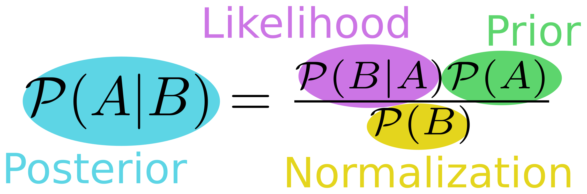
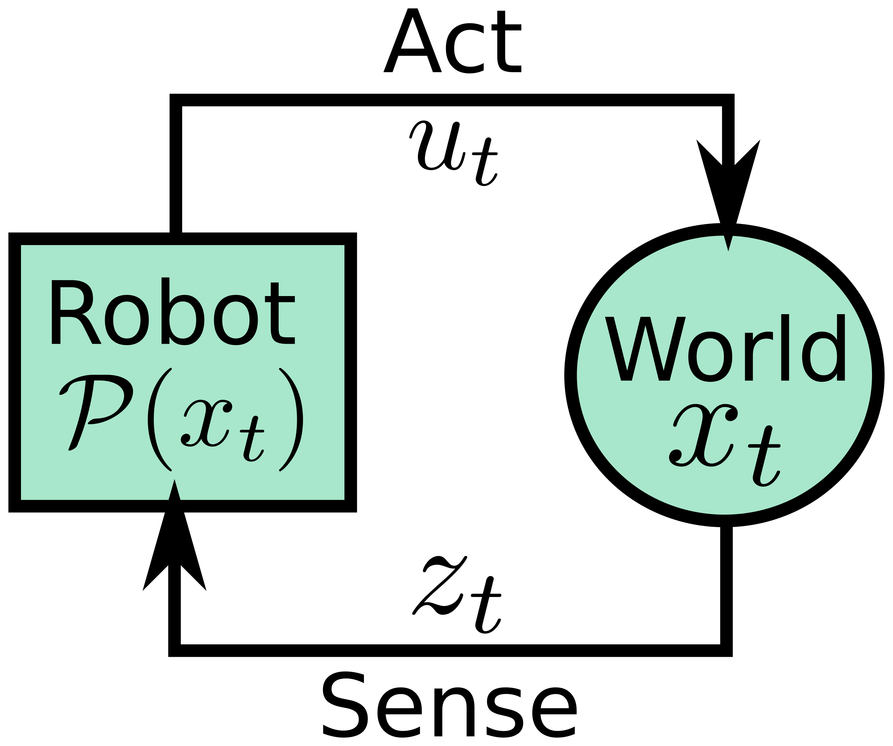
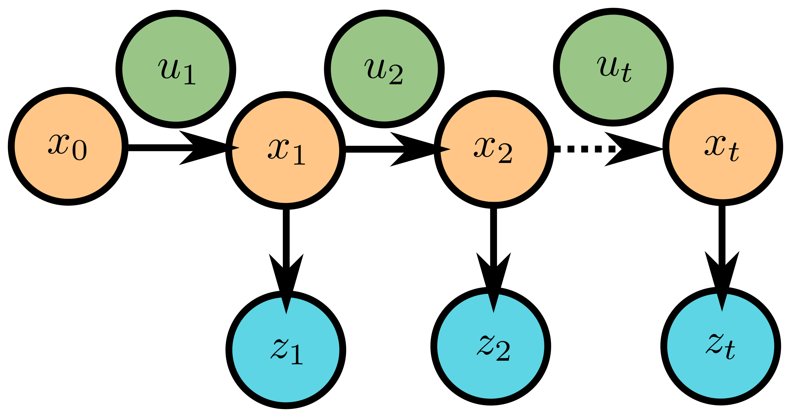

## Today
* Bayesian Filtering Mathematical Principles
* Beyond Particle Filtering Mini-Lecture (optional)
* Studio Time

## For Next Time
* Work on the [Robot Localization project](../assignments/robot_localization)
  * Demos due on **Monday October 19th by Class**
  * Code + Writeups due on **Tuesday October 20th 7PM**
  * Reflection due by **Tuesday, October 27th 7PM**
* Review the project description for [Broader Impacts Phase 2](../assignments/broader_impacts)
  * In class discussions on **Monday November 2nd**
  * Materials due **Tuesday November 3rd** (See [Canvas Page](https://canvas.olin.edu/courses/1070/assignments/20095))
* Read over the [Machine Vision Project Document](../assignments/computer_vision_project).
    * Project Proposal is due on **Wednesday October 21st at 9PM**. We'll have some in-class time next week to create these proposals.


## Bayesian Filtering and the Particle Filter

> Legacy notes about Bayes Filters and the Particle Filter from Paul Ruvolo are available: [as a video lecture](https://www.youtube.com/embed/l7CrjOTlioU) and as [physical notes](updated_bayes_filter.pdf). 

> Slides walking through a detailed version of our in-class derivation [here](https://docs.google.com/presentation/d/1Tkhmazzc0dVuyNIYOSlRL5IOWZ-xcoB_fTp06xpm1UI/edit?usp=sharing).

For your projects, you're implementing a particle filter, which is a subclass of algorithm under the more general category of _Bayesian filters_. A Bayesian filter is a recursive, or sequential, algorithm -- for localization, this means that the robot's state estimate is refined iteratively as observations or actions are taken.


### Bayes Rule
At the heart of Bayesian filters and Bayesian estimation is Bayes Rule or Bayes Theorem, stated simply as thus:

$$\mathcal{P}(A \vert B) = \frac{\mathcal{P}(A,B)}{\mathcal{P}(B)} = \frac{\mathcal{P}(B \vert A)\mathcal{P}(A)}{\mathcal{P}(B)}$$

Bayes Theorem is a method for computing a conditional probability: the probability of event A given event B. In many situations, this conditional probability is not necessarily obvious to compute; and this Bayes Rule gives us a way to compute this probabilty given knowledge of event B (which is typically more accessible to us) and an estimate for the probability of A without any context (something that is also typically more accessible to us, in a naive way). 

<p align="center">

</p>

Take for example a warehouse robot localization problem:
* _What is the probability that our warehouse robot is in aisle 17?_ This statement is known as our _prior_, and is expressed as $$\mathcal{P}(A)$$. In this scenario, assuming we know nothing, we might simply give this the probability of 1 over the total number of aisles in the warehouse (fun fact: this is known as the uninformative or uniform prior).
* _What is the probability that our robot sees a sign with the marker "17" in it, given that it is in Aisle 17?_ This statement is known as our _likelihood_ and is expressed as $$\mathcal{P}(B \vert A)$$. This statement forces us to consider how reliable our sensor model is. In this case, our "event B" is "observing a sign with a "17" in it" and our event A remains "being in Aisle 17". In general, knowing how well our sensor works under different conditions is accessible to us through testing and data collection.
* _What is the probability that our warehouse robot is in aisle 17, given that it sees a sign with the marker "17" in it?_ This is ultimately what we're trying to find; it is known as the posterior and is expressed as $$\mathcal{P}(A \vert B)$$. Since we have information from our sensor, and we know how well our sensor works, the aim is that our posterior estimate is _more informative_ than our prior estimate (which is typically uninformed). Thus, Bayes Rule gives us the ability to _update_ the belief about our state from sensor observations!
* _What is the probability of any given sensor observation?_ This statement is our _normalizing factor_ in Bayes Rule, expressed $$\mathcal{P}(B)$$ and simply ensures that whatever probabilities we compute follow our probability rules (that they normalize to 1).


### Bayes Rule for Robots
In our particle filters, we've been using the notion of _motion_ and _observation_ as data for our estimation. We can incorporate two types of data into a Bayes Filter directly, using this form:

$$\mathcal{P}(A \vert B,C) = \frac{\mathcal{P}(B \vert A,C)\mathcal{P}(A \vert C)}{\mathcal{P}(B \vert C)}$$

**Philosophy and Simplifying Assumption**
<p align="center">

</p>

Our robot interacts with a world, which has some state $$x_t$$. Our robot can affect the world by taking actions, $$u_t$$ or sense the world by taking measurements $$z_t$$. By interacting with the world, the robot can update its _belief_ about the world, which we represent as a probability distribution over possible states, $$\mathcal{P}(x_t)$$.

A robot is typically interacting _sequentially_ with the world, iteratively taking actions and drawing measurements. Under this sequential model, we make a _Markov assumption_ -- essentially, that the current state of the world is only depends on the most recent state of the world and the most recent action taken within that world. This Markov assumption means that the robot doesn't need to carry its entire history in memory and re-compute from square 1 an estimate of the state of the world; instead it can iteratively compute a new estimate from its previous estimate and new context that it collects. This Markov assumption is very common in robotics, and is also what will allow us to utilize Bayesian estimation tools effectively!

<p align="center">

</p>

**Key Idea**
We can now precisely re-state our Bayes Rule with this symbology:

$$\mathcal{P}(x_t \vert u_{1:t},z_{1:t}) = \frac{\mathcal{P}(z_{1:t} \vert x_t,u_{1:t})\mathcal{P}(x_t \vert u_{1:t})}{\mathcal{P}(z_{1:t} \vert u_{1:t})}$$

On inspection, we see that the first term in our numerator is the same as our _observation model_ and the second term in our numerator is the same as our _motion model_! This is where the algorithmic form for our particle filter comes from!


### A Discrete Example
Imagine that we have a robot that can (attempt) to open doors, and (attempt) to measure the state of a particular door. In this world, the door is either closed or open, and we don't have any particular idea where this world starts:

$$x_t = \{0 \text{ or } 1\} \text{ is our state space}$$

$$\mathcal{P}(x_0) = 1/2 \text{ is our prior probability}$$

Naturally, our robot can't directly or perfectly sense the state of the world, but it does have a noisy sensor and a noisy actuator it can use to guess the state of the world. Our robot's sensor (determined from experimentation) has the following properties:

$$\mathcal{P}(z_t = 1 \vert x_t = 1) = 3/5 $$

$$\mathcal{P}(z_t = 1 \vert x_t = 0) = 1/5 $$

Note: there are two other terms to our sensor model that aren't written down here...what are they?

Our robot's actuator has the following characteristics:

$$\mathcal{P}(x_t = 1 \vert x_{t-1} = 0, u_t = 0) = 0 $$

$$\mathcal{P}(x_t = 1 \vert x_{t-1} = 1, u_t = 0) = 1 $$

$$\mathcal{P}(x_t = 1 \vert x_{t-1} = 0, u_t = 1) = 4/5 $$

$$\mathcal{P}(x_t = 1 \vert x_{t-1} = 1, u_t = 1) = 1 $$

Note: there are four other terms in our actuator model that aren't written down here...what are they?

**Probability Question** I now pose the following question: _what is the probability that the door is open, given that the robot observes that it is open and has taken no action?_

$$\mathcal{P}(x_1 = 1 \vert z_1 = 1, u_1 = 0) = \text{ ?? }$$

**Approach Using Bayes Rule** Let's start by setting up our Bayes Rule implementation, which just follows the general pattern for Bayes Rule with two conditions:

$$\mathcal{P}(x_1 = 1 \vert z_1 = 1, u_1 = 0) = \frac{\mathcal{P}(z_1 = 1 \vert x_1 = 1, u_1 = 0)\mathcal{P}(x_1 = 1 \vert u_1 = 0)}{\mathcal{P}(z_1 = 1 \vert u_1 = 0)}$$

Now, let's take this one piece at a time, and substitute in what we know, starting with our _observation model_ or _likelihood_:

$$\mathcal{P}(z_1 = 1 \vert x_1 = 1, u_1 = 0) = \mathcal{P}(z_1 = 1 \vert x_1 = 1) = 3/5$$

This portion of our system is pretty straightforward -- we can nearly read it off our starting conditions! But there is one key thing we did here to help us: we realized that our observation was independent of our action; our action has no bearing on what is observed, allowing us to completely ignore that term in our conditional probability statement.

Now, let's pay attention to our _action model_ or _prior_:

$$\mathcal{P}(x_1 = 1 \vert u_1 = 0)$$

$$\text{apply Markov assumption: } \mathcal{P}(x_1 = 1, x_0 = 0 \vert u_1 = 0) + \mathcal{P}(x_1 = 1, x_0 = 1 \vert u_1 = 0)$$

$$\text{rearrange: } \mathcal{P}(x_0 = 0 \vert u_1 = 0)\mathcal{P}(x_1 = 1 \vert x_0 = 0, u_1 = 0) + \mathcal{P}(x_0 = 1 \vert u_1 = 0)\mathcal{P}(x_1 = 1 \vert x_0 = 1, u_1 = 0)$$

$$\text{plug in from our model: } 1/2 \times 0 + 1/2 \times 1$$

$$\text{solve: } 1/2$$

This portion is a little trickier, but we can use the Markov assumption to help us out and add back in our prior state -- since our current state is going to be contingent on our action and what the state of the world _was_ when we started. We expand our probability statement to include what our prior state could have been. From there, we just re-arrange the terms until we get something that we can plug in directly: our prior probability on state and our action model.

And so, our final probability (with some normalizing factor $$\mu$$) is simply:

$$\mathcal{P}(x_1 = 1 \vert z_1 = 1, u_1 = 0) = \mu \times 3/10$$
 
$$\mathcal{P}(x_1 = 1 \vert z_1 = 1, u_1 = 0) \propto  3/10$$

An optional exercise for you is computing the normalizing constant $$\mu$$? Hint: the probability of $$x_1 = 1$$ and $$x_1 = 0$$ needs to sum to 1!


### Connection to the Particle Filter
We can operationalize the computation of Bayes Rule into the formula we know and now love:

```
1) Initialize with an estimate of the first pose
2) (Predict) Take an action, and predict the new pose based on the motion model
3) (Correct) Correct the pose estimate, given an observation
4) Repeat steps 2 and 3, ad nauseum (or until your robot mission is over)
```

A Bayesian filter, in its purest form, asks us to work with continuous probability distributions, and that is computationally challenging (nigh intractable) most of the time for practical robotics problems. The particle filter addresses these computational challenges by allowing us to _draw samples from our probability distributions_ and apply our prediction and correction steps to each of those samples in order to get an empirical estimate of a new probability distribution. In this way, the particle filter is a _Monte Carlo_ algorithm, and leverages the law of large numbers to "converge" towards the optimal answer. (You can get a sense about why sampling works to find complex distributions by [playing with this applet](http://chi-feng.github.io/mcmc-demo/app.html?algorithm=GibbsSampling&target=banana)).


## Beyond Particle Filtering (Optional Mini-Lecture)
In this optional mini-lecture and activity, we'll discuss a different class of Bayesian filter for state estimation and localization: the Kalman filter. A complementary coding activity for this mini-lecture can be pulled from [this repository](https://github.com/comprobo25/recitation_examples/tree/main/kalman_filters) -- note that this only requires Python to run; this is not a ROS2 based example. For those interested in going even further, you can play with this [CoLab Notebook from 2024](https://colab.research.google.com/drive/1Sbm81zccVfqPNaV6w9rdGH56F1uCTUIF?usp=sharing) which provides Extended Kalman Filter code.

The Kalman filter, invented by Thorvald Thiele, Peter Swerling, and Rudolph Kalman in the late 1950s/early 1960s, is a _continuous space_ Bayesian filter for linear-Gaussian systems. Like all Bayesian filters then, it is operationalized into the following steps:
```
1) Initialize with an estimate of the first pose
2) (Predict) Take an action, and predict the new pose based on the motion model
3) (Correct) Correct the pose estimate, given an observation
4) Repeat steps 2 and 3, ad nauseum (or until your robot mission is over)
```

The special assumption of a Kalman filter is that the world is (statistically) normal -- that is, we can use Gaussian distributions to describe our uncertainty about the world. Therefore, we can _directly compute_ the mean and variance of our robot's pose directly (under an assumption of linear dynamics)! 

The Kalman Filter is typically implemented in two steps, a _prediction_ step (motion model!) and an _update_ step (observation model / likelihood!). This follows directly from our definition of a Bayes filter.

### Prediction
In the first step, we want to simply compute the estimate of the state given our control inputs and transformation behavior of the system, and its corresponding covariance. For the Kalman filter, this is written simply as:

$$
\text{Kalman State Prediction: } x_t = F_t x_{t-1} + B_t u_t + w_t
$$

$$
\text{Kalman Covariance Prediction: } P_t = F_t P_{t-1} F_t^T + Q_t
$$

where:
* $$x$$ is our state vector
* $$u$$ is our input control vector
* $$F$$ is our transformation / transition matrix which maps from the previous state to the current state
* $$B$$ is our control matrix which maps from the control input to the state space
* $$w$$ is process noise
    * $$Q_t$$ is the covariance of the Gaussian distribution from which the process noise is drawn
* $$P$$ is the process covariance
* $$t$$ is an index indicating time step

The update step showcases the advantage of the linear-Gaussian assumption clearly. We are able to compute the distribution over multiple state variables _completely_ in a set of only two linear algebraic expressions.

### Update
Of course, the world doesn't always behave perfectly according to our transition and control model, so we would like to update our posterior estimate of state and state covariance from observations. 

For this, we will start with computing the _residual_ which is the difference between an actual measurement we took in the world, and the prediction of what that measurement ought to have been according to our state estimate:

$$
\text{Kalman Update Residual: } y_t = z_t - H_t \hat{x_t}
$$

where:
* $$y_t$$ is our residual data vector
* $$z_t$$ is our actual measurement
* $$H_t$$ is our measurement model matrix
* $$\hat{x_t}$$ is our _predicted_ state, following from the prediction step

Similarly, we can compute the _innovation_ (measurement residual) on the covariance as well:

$$
\text{Kalman Update Covariance Innovation: } S_t = H_t \hat{P_t} H_t^T + R_t
$$

where:
* $$S_t$$ is the innovation on covariance
* $$\hat{P_t}$$ is the _predicted_ process covariance, following from the prediction step
* $$R_t$$ is the measurement noise covariance

When computing the residuals, we are effectively computing an "error" term in state and an "uncertainty propogation" term in covariance. 

Ultimately, we want to use these residuals to correct our state estimate, essentially tempering our prediction with a dose of reality from our observations. To do this, we will make use of the "secret sauce" of a Kalman filter -- the Kalman Gain:

$$
\text{Kalman Gain: } K_t = \hat{P_t} H_t^T S_t^{-1}
$$

and apply it as:

$$
\text{Posterior Kalman State Estimate: } x_t = \hat{x_t} + K_t y_t
$$

$$
\text{Posterior Kalman Process Covariance: } P_t = (I - K_t H_t)\hat{P_t}
$$

We can think of the Kalman gain as a principled "tuning" parameter for our update step; it modifies how much we trust our residual statement (since after all, measurement models can be wrong too!). It is directly derived from an optimization problem that seeks to minimize the mean square error between the true state and the predicted state estimate.  

For completeness, you may see the final posterior estimates for the Kalman filter written in the following forms (for either ease of interpretation or numerical stability):

$$
\text{Posterior Kalman State Estimate (Equivalent Form): } x_t = (I - K_t H_t) \hat{x_t} + K_t z_t
$$

$$
\text{Posterior Kalman Process Covariance (Joseph Form): } P_t = (I - K_t H_t)\hat{P_t}(I - K_t H_t)^T + K_t R_t K_t^T
$$


### An Example Problem
Let's think about this problem for a very simple situation: a runaway Neato moving in a 1D world.

**Defining a State Variable and State Covariance**
The _state_ of our world is our Neato's position and velocity. We only get noisy estimates of the Neato position, and have no information about velocity. We can use the notation:

$$\mathbf{x} = [x, \dot{x}]^T$$

to represent the state of our Neato.

Since we're representing everything as a Gaussian, we need to define the variance we associate with our state (basically, how uncertain we are about our state). Since we have a two dimensional state, our covariance will be a 2x2 matrix:

$$\mathbf{P} = \left[
\begin{matrix}
\sigma_{xx} & \sigma_{x\dot{x}}\\
\sigma_{\dot{x}x} & \sigma_{\dot{x}\dot{x}}
\end{matrix}
\right]$$

where the diagonal elements are the variance in the state variables themselves, and the off-diagonal elements are the covariances between variables.

**The Prediction Step**
Also sometimes referred to as the "process model" in literature, this captures the (statistically) expected motion of our Neato. Since we're explicitly keeping track of uncertainty here, we must advance both our state and our uncertainty according to our transition model.

Since we are tracking the Neato moving in 1D, we might use the following model:

$$\hat{x_t} = v\Delta t + x_{t-1}$$

Vectorized per our defintion of state variable:

$$\hat{\mathbf{x}_t} = \mathbf{F}\mathbf{x}_{t-1}$$

$$ \left[\begin{matrix} \hat{x_t} \\ \hat{\dot{x_t}} \end{matrix}\right] = \left[
\begin{matrix}
1 & \Delta t\\
0 & 1 \end{matrix} \right] \left[\begin{matrix} x_{t-1} \\ \dot{x_{t-1}} \end{matrix}\right]$$

For advancing our state covariance, we can use:

$$\hat{\mathbf{P}_t} = \mathbf{F}\mathbf{P}_{t-1}\mathbf{F}^T + \mathbf{Q}$$

where $$\mathbf{Q}$$ is simply some process noise (we typically assume this to be zero-centered white noise).

**The Correction Step**
If we only had the prediction step, we'd basically be doing _dead-reckoning_ or open-loop estimation. But we can do better!

First, we need to define a measurement model. In our world, we can get noisy measurements of our position, but not of our velocity. Thus, we can define a residual function (the difference between our observation and our hypothesized observation per our update step) as:

$$ \mathbf{y} = \mathbf{z} - \mathbf{H}\mathbf{x}$$

$$\mathbf{H} = [1, 0]^T$$

where $$\mathbf{H}$$ is our sensor model.

Now, we want to update our pose estimate given our observation; to do this, we're going to compute the _Kalman gain_ -- we can think of this as a weight that uses our uncertainty to place our final pose estimate somewhere between our predicted pose and our residual (measured) location. The Kalman gain has the following structure:

$$K_t = \hat{\mathbf{P}_t}\mathbf{H}^T(\mathbf{H}\hat{\mathbf{P}_t}\mathbf{H}^T + \mathbf{R})^{-1}$$

where $$\mathbf{R}$$ is the observation noise on $$z$$.

Finally then, we can update our pose estimate and covariance as:

$$\mathbf{x}_t = \hat{\mathbf{x}_{t}} + K_t(z_t - \mathbf{H}\hat{\mathbf{x}_{t}})$$

$$\mathbf{P}_t = (\mathbf{I} - K_t\mathbf{H})\hat{\mathbf{P}_{t}}$$

where $$\mathbf{I}$$ is the identity matrix.

**Affordances and Notes**
One of the advantages of the Kalman filter is that it allows us to keep track of a closed form of uncertainty, which allows us to do interesting work at every step of the filter (of course, at the expense of assuming the world is Gaussian). 

One of the advantages of this closed form update step, with explicit models for world physics, is that we can directly estimate un-observables -- for instance, take velocity in this example. We never get an observation of velocity directly, however, we can refine our estimate of velocity alongside our estimate of position because we have a direct relationship between these variables and their covariances.

Many modern estimation algorithms in robotics rely on some form of Kalman filter. SLAM (simultaneous localization and mapping) has long used an Extended Kalman Filter (EKF) backbone to jointly estimate both robot pose and map at the same time. If you'd like to learn more, you can check out this [presentation on EKF SLAM](http://ais.informatik.uni-freiburg.de/teaching/ws12/mapping/pdf/slam04-ekf-slam.pdf) and this [5 minute SLAM overview](https://www.youtube.com/watch?v=BuRCJ2fegcc), both by Cyrill Stachniss.
