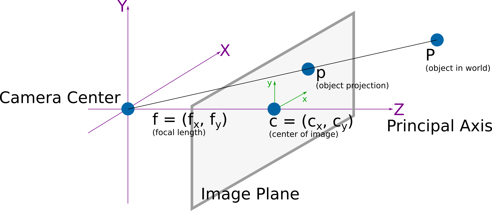
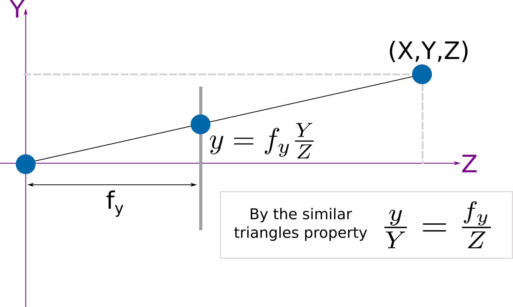
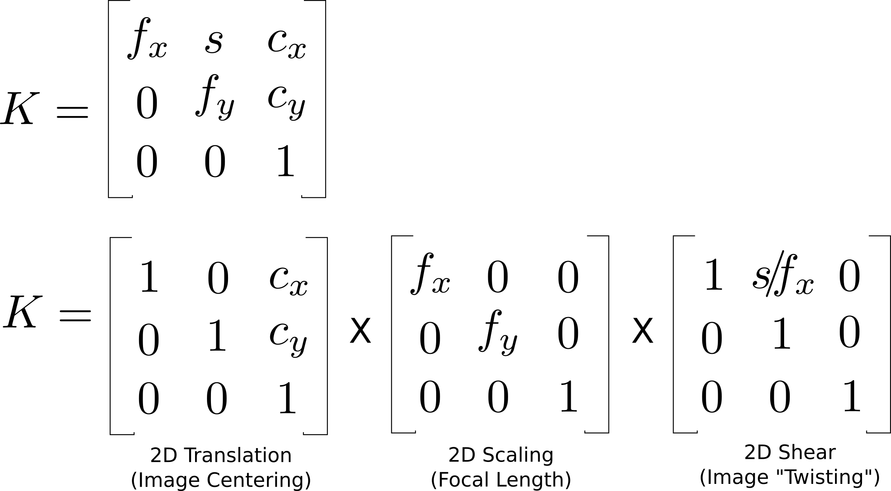
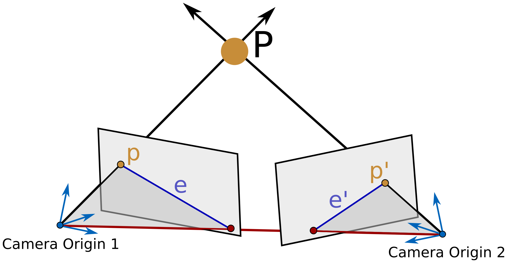

## Today
* About Metric Information
* Camera Calibration
* Keypoints, Descriptors, and Matching
* Studio Time

## For Next Time
* Work on [Broader Impacts Phase 2](../assignments/broader_impacts)
  * In class discussions on **Monday November 2nd**
  * Materials due **Tuesday November 3rd** (See [Canvas Page](https://canvas.olin.edu/courses/1070/assignments/20095))
* Work on the [Machine Vision Project Document](../assignments/computer_vision_project).
    * Project Proposal is due on **Wednesday October 21st at 9PM**.
    * Project Shareouts will be **Monday November 9th in class**
    * Project Materials are due on **Tuesday November 10th at 7PM**
* Please provide feedback and weigh-in on an extra credit opportunity! [Poll](https://forms.gle/zVMMPGQrxwBxWfj86)


## About Metric Information from Images
We discussed last time that images contain a lot of _information_ including metric (structural) data and semantic (contextual) data. This week, we're going to focus our discussions on considering how metric information can be extracted from images. 

Recall again that images are composed of pixels (2D coordinates in an image space) and colorspaces (multiple channels mapping to light intensities of different qualities). How do we get metric information (like object poses) from this data structure? 

The secret: from a single image, this is extremely difficult; but from a pair of images, we can extract metric information using simple geometric transformations.

Today, we will talk about the key ways an image set needs to be prepared to extract metric information:
* Calibration (e.g., image rectification) -- both intrinsic (unwarping an image) and extrinsic (mapping pixels to real world scales)
* Keypoint Detection
* Descriptor Extraction
* Descriptor Matching
* Geometric Transformations


## Camera Calibration
Physically, your camera consists of a lens and an imaging sensor. The lens casts light from a scene onto the sensor, which is (typically) a grid of photoreceptors which converts light to electrical signals indicating light intensity, color, or other metrics. The geometry of the lens and the imaging sensor impact what is rendered as the "image" that is a piece of data. Camera calibration is the process of estimating this geometry in order to apply a software filter that can "undistort" images into rectified copies that are more suitable for downstream metric extraction tasks.

Thus, one of the _essential_ practical aspects of machine vision is camera calibration: knowing the intrinsic and extrinsic parameters of your imaging system. 

* _Intrinsic Calibration_ refers to the sensor and lens characteristics of your imaging system; calibrating here allows you to correct for image distortions. This is a "projective transformation" between your camera coordinates and your image pixel coordinates.
* _Extrinsic Calibration_ refers to the way in which your imaging system is set up. For instance, if you have two cameras, this would include their relative poses to one another. This is a "rigid transformation" between your world coordinates and your camera coordinates.

### Pinhole Camera Model 
The "pinhole camera model" is among the most commonly used for performing basic camera calibration. These [slides for today](https://docs.google.com/presentation/d/1Iwnoi7UKkcQ3rvCax6-f-ZoQDhUIjUSaIHZvhTS56q8/edit?usp=sharing) go through the key details. Please use this as a resource!

#### Intrinsic Calibration
For computing the _intrinsic_ calibration parameters, we can use some simple projection math to help us out:



On inspection, we can see that there are a few properties we need to correct for when thinking about image distortion:
* How the center of the camera translates to the center of the image 
* How the _focal length_ controls the amount of "zoom" in the image
* How any _axis skew_ might impact asymmetries in the projection

The focal length is probably new to many of us, and is a term in photography to describe the distance at which a camera is focused (that is, the natural length for which everything from that distance to the camera will appear to be in-focus). On an image, the focal length and field-of-view control how far away an object happens to appear. The focal length helps us to predict how a real world object a certain distance from the camera will be projected onto the image. Simple "similar triangles" math is used for this:



As it turns out, each of the image distortion properties we've identified above are all simple linear translations! So, we can create a camera calibration matrix $$K$$ that is a composition of these corrections, which we can apply to a vector of real-world coordinates to estimate pixel coordinates:



This explainer has an [interactive applet](https://ksimek.github.io/2013/08/13/intrinsic/) that allows you to adjust each of the intrinsic parameters to see how that changes how an image renders to get more intuition.


#### Extrinsic Calibration
Especially when we have two or more images, the extrinsic calibration captures _how the camera moves from frame to frame_. This is extremely useful in the following scenarios:
* **Stereo Cameras** -- if we collect two images at the exact same time, the extrinsic calibration tells us how the 3D poses of the cameras relate to each other. 
* **Moving Cameras** -- if we collect two images of an object at two different times from a mobile robot, the extrinsic calibration tells us how the 3D camera poses changed between each image. 

By knowing the extrinsic calibration, we can use the difference in perspective between the cameras to estimate where an object being imaged exists in 3D space, which helps us recover a sense of _depth_ in an image.

For computing the _extrinsic_ calibration parameters, we will be making use of some additional projection math. This honestly gets messy, but [here is some visual intuition](https://ksimek.github.io/2012/08/22/extrinsic/). Fundamentally, we want to estimate the _translation_ and _rotation_ of a camera between two images. Thus, we need to understand how a pixel in one image maps to a pixel in another image. _Epipolar geometry_ is used to help us out for finding the _Fundamental matrix_ (which is a combo of the translation and rotation between images). This [explainer](https://web.stanford.edu/class/cs231a/course_notes/03-epipolar-geometry.pdf) is super useful!




In practice, there are often too many pixels to use them all for computing translation and rotation, and so an approximate method, like the [8-point algorithm](https://www.cs.cmu.edu/~16385/s17/Slides/12.4_8Point_Algorithm.pdf) is used. As the name suggests, this algorithm select 8 corresponding points between images and solves the linear system of equations to actually estimate the translation and rotation. 


### Implementation Example
We're going to be using a "checkerboard calibration method" in this class. To get a broad sense of why this works, this is a nice [quick video explainer](https://www.youtube.com/watch?v=26nV4oDLiqc) that summarizes the method and how it intersects with our projection math. A [much longer version that gets into the details](https://www.youtube.com/watch?v=-9He7Nu3u8s) is another good watch after the class!

To understand more about how this is implemented in practice, let's checkout this [brief OpenCV demo](https://docs.opencv.org/4.x/dc/dbb/tutorial_py_calibration.html) and run it ourselves on our webcams (you'll only need python for this!). Note that you'll need checkerboards for this! You can (and should!) print your own; this [calib.io pattern generator](https://calib.io/pages/camera-calibration-pattern-generator) is an excellent resource. Make sure when printing that you use the true size of the PDF or re-take your own measurements afterward.


### Camera Calibration Resources (For Your Consideration)
Here are several different tutorials on how to do (intrinsic) camera calibration in ROS2:

* [Using the Camera Calibration module](https://wiki.ros.org/camera_calibration)
* [Using the Nav2 module](https://docs.nav2.org/jazzy/tutorials/general_tutorials/camera_calibration/camera_calibration/)
* [A Medium Post walk-through](https://medium.com/starschema-blog/offline-camera-calibration-in-ros-2-45e81df12555)

Some additional learning materials include:
* An article on <a-no-proxy href="https://www.ri.cmu.edu/pub_files/pub2/willson_reg_1993_1/willson_reg_1993_1.pdf"> What is the Center of an Image? </a-no-proxy> 
* MatLab has a nice [high-level explainer](https://www.mathworks.com/help/vision/ug/camera-calibration.html) with follow-on articles worth a look. 
* A [video lecture](https://www.youtube.com/watch?v=Ou9Uj75DJX0) on camera calibration, especially as it relates to robot systems and photogrammetry (this whole series may be of interest to you!)


## Keypoints, Descriptors, and Matching
These [slides on keypoints and descriptors](https://docs.google.com/presentation/d/1qfmZoR6h3JrrKfDhOjHQEO0OzsS_WONfZtU30wUSh5Q/edit?usp=sharing) provide a detailed look at this topic. As many projects in the class will likely build on the notion of keypoints/descriptors, we highly recommend using this as a resource to learn more!

To get a brief impression of keypoints, descriptors, and matching, there is some demonstration code available in the [``class_activities_and_resources`` repository](https://github.com/comprobo26/class_activities_and_resources) under the subdirectory ``keypoints_and_descriptors``. Since this directory is not a ROS package, you do *NOT* need to worry about running ``colcon build``. Remember to pull from upstream!

### Keypoint-based Tracking

You can use keypoints to track an object as it moves around in an image.  Go to the ``keypoints_and_desciptors`` directory and run the following command.

```bash
$ ./track_meanshift_keypoints.py
```

You should see an image from your computer's webcam appear on the screen.  Click the image once to pause it, a second time to mark the upper-left corner of the tracking image, and a third and final time to mark the lower-right corner of the tracking image.

At this point you should be able to move the object around and the program will attempt to track its position.

> What do you notice about the keypoints that are selected? What changes when you adjust the "corner threshold" and why? What changes when you adjust the "ratio threshold" and why?

> Look at the code for this example. What types of features are being used? What happens if you change them to one of the other common feature types (e.g., ORB -- check the slides and OpenCV documentation for others!)


### Matching Keypoints
You can use keypoints to match corresponding points in two images.  Go to the ``keypoints_and_desciptors`` directory and run the following command.

```bash
$ ./match_keypoints.py
```
Note that as you move the sliders around, you'll need to click on the image to refresh it.

> What do you notice about the keypoints that are selected? What changes when you adjust the "corner threshold" and why? What changes when you adjust the "ratio threshold" and why?

> Look at the code for this example. What types of features are being used? What happens if you change them to one of the other common feature types (e.g., ORB -- check the slides and OpenCV documentation for others!)


### Visualizing SIFT Descriptors
You can visualize the SIFT descriptors, which we used in the previous two demos. Go to the ``keypoints_and_desciptors`` directory and run the following command.

```bash
$ ./visualize_sift.py
```

This visualization is showing the SIFT descriptors as described in the slides.  The only thing that it doesn't do is rotate the descriptor relative to the dominant orientation.  Draw in the left pane by clicking and dragging, make sure that you understand why the SIFT descriptor changes the way that it does.  Note, that in order to reset the sketch, you need to hit the spacebar.

> What are the advantages of using SIFT descriptors? When might you not want to use a SIFT descriptor?


### Machine Learning-based Tracking
You may want to try out Magic Leap's SuperGlue model for keypoint identification and tracking.  They [have a repository](https://github.com/magicleap/SuperGluePretrainedNetwork) that is pretty easy to get going with.

> Why might using learned descriptors be attractive? What are challenges associated with using these descriptors?

YOLO is another well-known learned descriptor / keypoints detector, often used for human pose estimation, that many of you are looking at for your projects. You can learn more about how it may connect to robotics [by reading academic papers](https://arxiv.org/pdf/2510.13625) in this space.